# oneokai.nvim


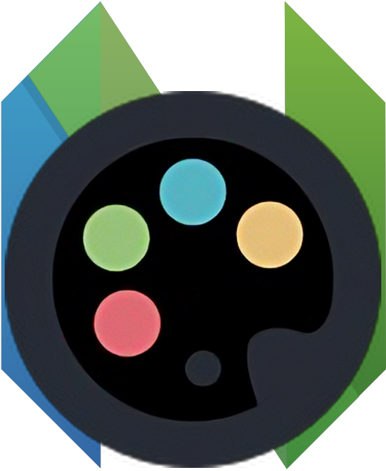 

A fork of [onedark.nvim](https://github.com/navarasu/onedark.nvim), 
converted to be similar to [One Monokai](https://github.com/azemoh/vscode-one-monokai) not an exact copy.

Works with Neovim's built-in tree-sitter highlighting and LSP semantic tokens, and has support for many plugins.
> Developed and tested on Neovim 0.11, with an up-to-date [nvim-treesitter](https://github.com/nvim-treesitter/nvim-treesitter).


When I first started using NeoVim I wanted to use one of my favorite color themes, One Monokai. 
So I googled around and found [cpea2506/one_monokai.nvim](https://github.com/cpea2506/one_monokai.nvim). 
It looked like the thing a wanted, but I noticed that in some cases that the colors felt of and some things where had the wrong color. So I switched to using onedark.nvim. But I was missing one monokai. 
So I decided to fork onedrak.nvim and remap the colors to be more like one monokai. Meaning that I have done a direct color re-mapping from onedark.nvim to One Monokai.
but the main colors are still from one dark, just a re mapping of colors.

## install 
Install via package manager
```vim
" Using Vim-Plug
Plug 'AxelGard/oneokai.nvim'
```
or
```lua
-- Using Packer
use 'AxelGard/oneokai.nvim'
```

## themes 

Since oneokai is a fork the same themes as onedark has. 
there are some example screen shoot. 

The default is dark theme.

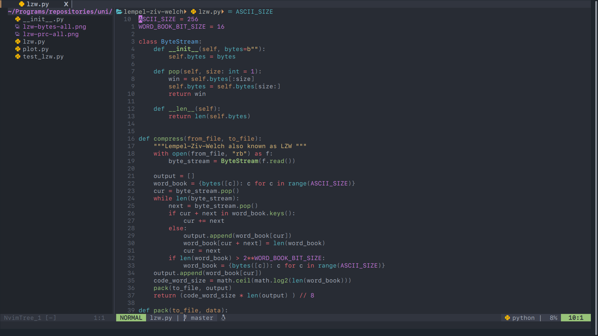

But I would recommend you use darker, darkplus.

### dark, darker 

<p float="left">

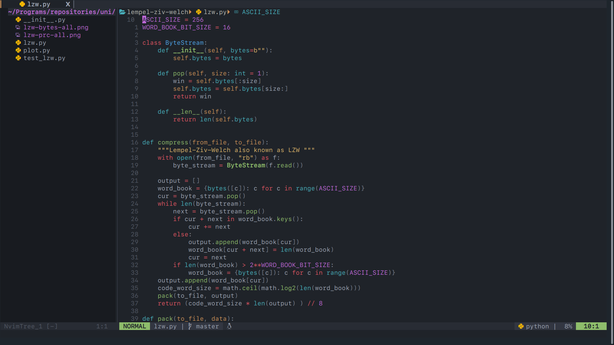
</p>

### cool, deep

<p float="left">
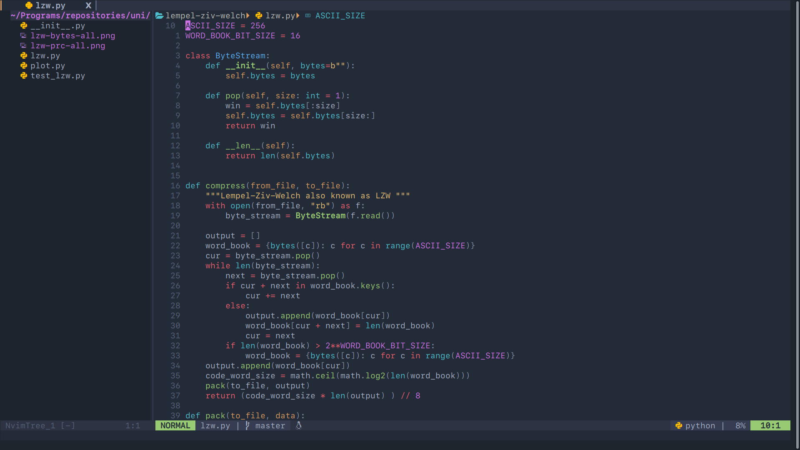
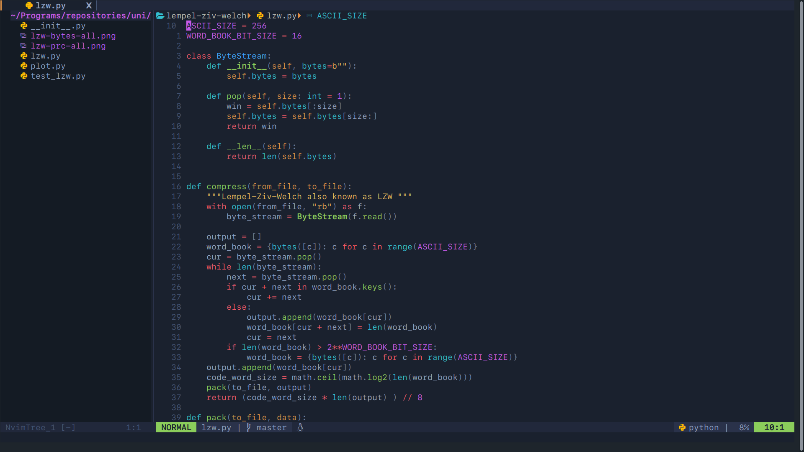
</p>

### warm, warmer

<p float="left">
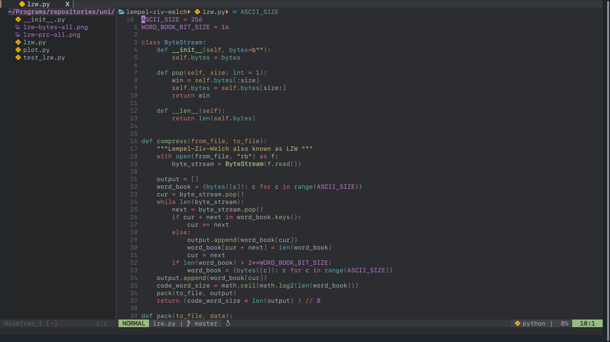
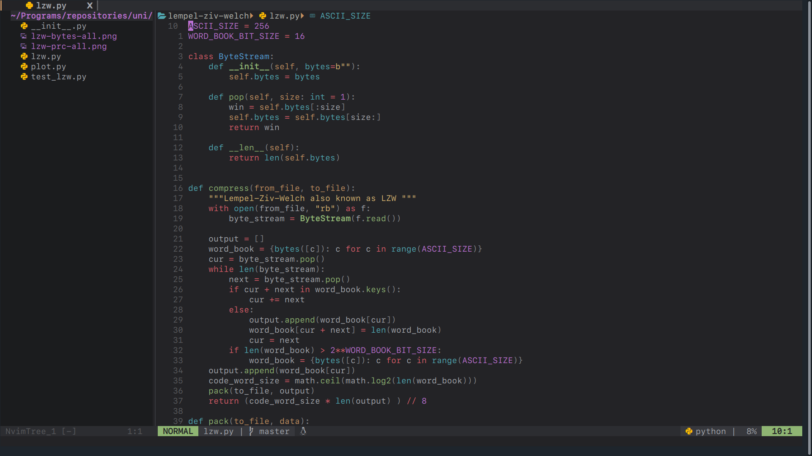
</p>

### darkplus, black 

<p float="left">
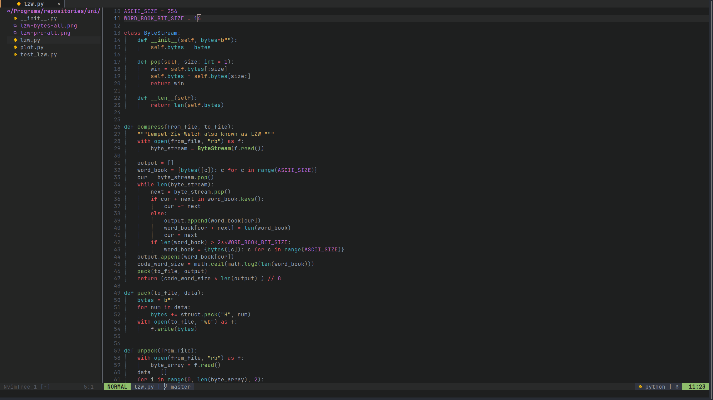
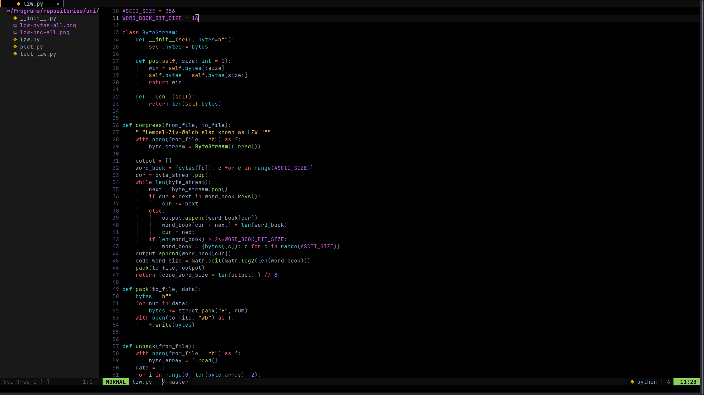
</p>

### notdark, paper 

<p float="left">
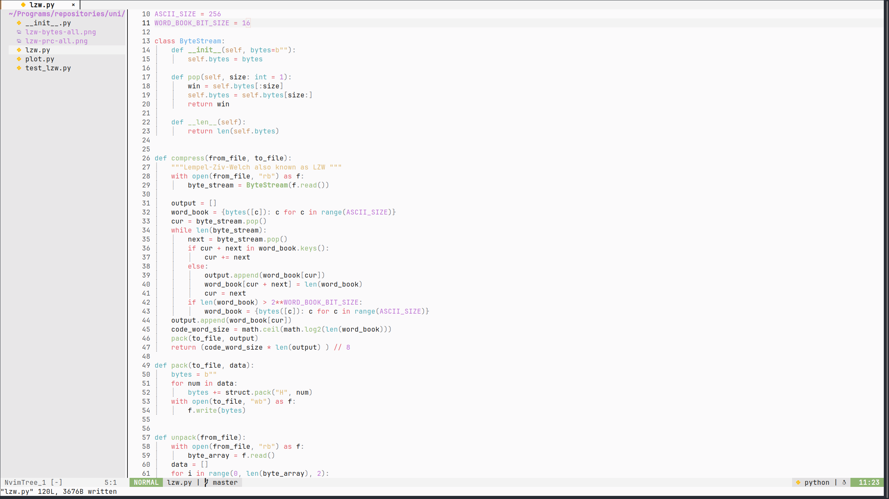
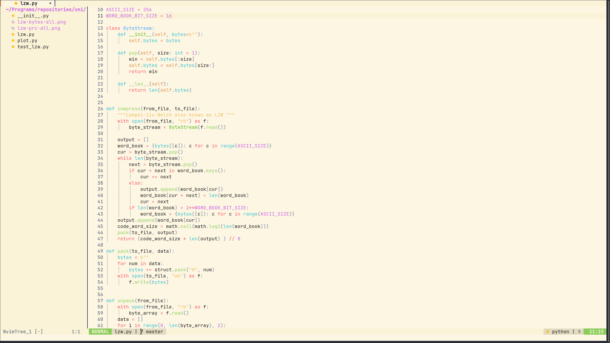
</p>

## setup and config 

enable the theme 
```vim
" Vim
colorscheme oneokai
```

```lua
-- Lua
require('oneokai').load()
```

## styles 

There are some pre defined styles of the oneokai theme:

| | styles |
|---|---|
| dark | `dark`, `darker`, `darkplus`, `black`, `cool`, `deep`, `warm`, `warmer`, `idea_dark`, `mat`, `nord`, `everforest`, `catppuccin_macchiato`, `catppuccin_frappe`, `gruvbox_material` |
| light | `notdark`, `paper` (`light` is the same as `notdark`) |

The original ones are based on the [onedark.nvim#themes](https://github.com/navarasu/onedark.nvim#themes).
The light styles also set `background=light`. An unknown style name shows a warning and falls back to `dark`.

You can change it by

```lua
-- Lua
require('oneokai').setup {
    style = 'deep'
}
require('oneokai').load()
```
```vim
" Vim
let g:oneokai_config = {
    \ 'style': 'deep',
\}
colorscheme oneokai
```

### toggle between styles

```lua
require('oneokai').setup {
    toggle_style_key = '<leader>ts',
    toggle_style_list = { 'dark', 'idea_dark', 'paper' }, -- default: dark, darker, cool, deep, warm, warmer, light, idea_dark
}
```

## all options

These are the defaults, you only need to set the ones you want to change.

```lua
require('oneokai').setup {
    style = 'dark',
    toggle_style_key = nil,       -- keymap to cycle through toggle_style_list
    toggle_style_list = { 'dark', 'darker', 'cool', 'deep', 'warm', 'warmer', 'light', 'idea_dark' },
    transparent = false,          -- don't set the background
    term_colors = true,           -- set the :terminal colors
    ending_tildes = false,        -- show the ~ at the end of buffers
    cmp_itemkind_reverse = false, -- reverse the item kind highlights in the cmp menu

    -- 'none', or one or more of 'italic', 'bold', 'underline', ... e.g. 'italic,bold'
    code_style = {
        comments = 'italic',
        keywords = 'none',
        functions = 'none',
        strings = 'none',
        variables = 'none',
    },

    lualine = {
        transparent = false, -- transparent center bar
    },

    colors = {},     -- override or add palette colors, see below
    highlights = {}, -- override highlight groups, see below

    diagnostics = {
        darker = true,     -- darker colors for diagnostic virtual text
        undercurl = true,  -- undercurl instead of underline
        background = true, -- background color behind virtual text
    },
}
```

## customizing colors and highlights

`colors` changes the palette of the style you use, or adds new colors.
`highlights` changes highlight groups. Colors can be a hex value or `$name` for a palette color.

```lua
require('oneokai').setup {
    colors = {
        red = '#ff5f5f',        -- change an existing color
        bright_pink = '#ff6ad5', -- add a new one
    },
    highlights = {
        ['@keyword'] = { fg = '$bright_pink', fmt = 'bold' },
        ['@string'] = { fg = '$green' },
        ['@comment.todo'] = { link = 'Todo' },
        Normal = { bg = '#000000' }, -- only bg is changed, fg is kept from the theme
    },
}
```

Each highlight takes `fg`, `bg`, `sp` (underline color), `fmt` (`'bold,italic'`, ...) or `link` (another group).
Only the attributes you set are changed, the rest is kept from the theme.
An unknown color name or key shows a warning instead of being silently ignored.

Many tree-sitter captures link to the classic groups, so changing `Keyword` also changes `@keyword`,
and changing `String` also changes `@string`.

To find which group colors something, put the cursor on it and run `:Inspect`.

Tree-sitter highlighting uses the current [nvim-treesitter](https://github.com/nvim-treesitter/nvim-treesitter) capture names
(`@keyword.conditional`, `@variable.member`, `@markup.heading`, ...), so keep nvim-treesitter up to date.

## changing the theme itself

The highlight groups are in `lua/oneokai/groups/`, one file per area:

```
lua/oneokai/
  palette.lua       -- the colors of every style
  default.lua       -- default options, toggle list, light styles and style aliases
  highlights.lua    -- applies the groups and your overrides
  groups/
    init.lua        -- the list of group files, in the order they are loaded
    editor.lua      -- Normal, CursorLine, Pmenu, StatusLine, ...
    syntax.lua      -- Keyword, String, Function, ... (classic vim groups)
    treesitter.lua  -- @keyword, @function, ... for all languages
    lsp.lua         -- diagnostics and LSP references
    kinds.lua       -- completion/symbol kind colors (cmp, aerial, navic)
    langs/          -- one file per language: bash, c, c_sharp, cpp, html, java, json, kotlin, markdown, python, tsx, ...
    plugins/        -- one file per plugin: telescope, gitsigns, neo_tree, mini, ...
```

Every group file looks like this:

```lua
return function(c, cfg, fg)
    return {
        TelescopeBorder = fg.light_grey,
        TelescopeMatching = { fg = c.purple, fmt = 'bold' },
        TelescopeSelection = { link = 'CursorLine' },
    }
end
```

* `c.red` is a palette color (`'#e86671'`)
* `fg.red` is short for `{ fg = c.red }`, it exists for every palette color
* `cfg` is the config, e.g. `cfg.code_style.keywords` or `cfg.transparent`

**Change a language**: open its file in `langs/`. Most of them list the captures that language uses as comments,
with the value they have today, so uncomment one and change the color. These only affect that language,
e.g. `["@keyword.modifier.java"]` only changes Java.

**Add a language or plugin**: create a new file in `langs/` or `plugins/` and add its name to the list in `groups/init.lua`.

## lualine 

Oneokai has lualine support

```lua
require('lualine').setup {
  options = {
    theme = 'oneokai',
    -- ... your lualine config
  }
}
```

---
* This theme is a fork of [onedark.nvim](https://github.com/navarasu/onedark.nvim).
* The colors are based on the [One Monokai](https://github.com/azemoh/vscode-one-monokai) theme for vscode.
